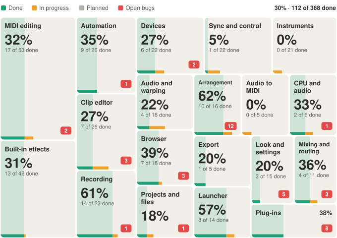

# suhina-status

Suhina's status figure: how much of each area of [Suhina](https://github.com/suhina-daw/suhina-daw) works today. One box per area, sized by its number of features and filled by the share done; the red number is the area's open bugs.

<picture>
  <source media="(prefers-color-scheme: dark)" srcset="status-dark.svg">
  
</picture>

A bot draws `status.svg` and `status-dark.svg` from the maintainers' feature count and the open bugs of each `area:` label, and pushes them here after every change and once a day. Nothing here is edited by hand; the README of suhina-daw/suhina-daw shows these files.

GPL-3.0-or-later, like Suhina.
